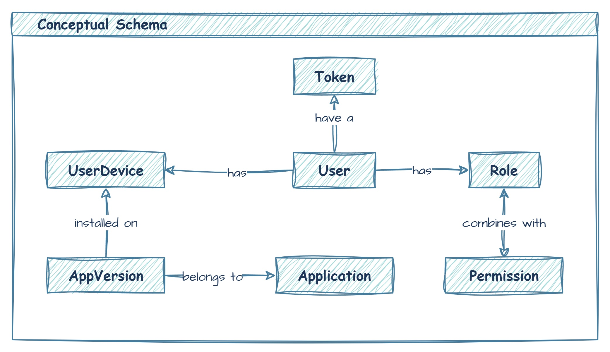
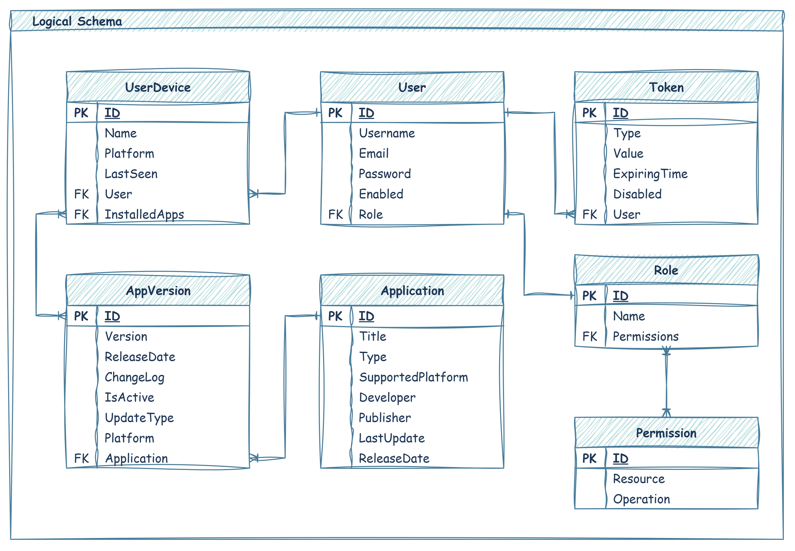
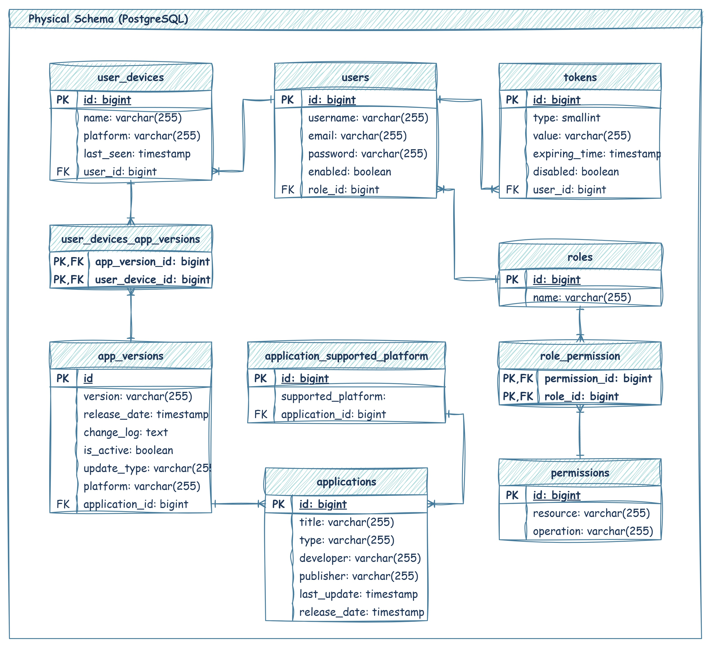

# 🚀 Cross Platform Updater API


[](https://www.docker.com/)
[](https://spring.io/projects/spring-boot)
[](https://www.jwt.io)
[](https://www.postgresql.org/)


### Spring Boot, PostgreSQL, Spring Security, JWT, JPA, Rest API
A modern REST API for managing cross-platform application updates, versions, and user devices. Built with Spring Boot and containerized with Docker for seamless deployment.


## ✨ Features

- **Application Management**: Create, update, and filter applications across multiple platforms
- **Version Control**: Manage application versions with release dates, changelogs, and update types
- **Device Registry**: Track user devices and their installed applications
- **JWT Authentication**: Secure endpoints with token-based authentication
- **Auto-Documentation**: OpenAPI 3.1 compliant API documentation
- **Containerized**: Full Docker support with PostgreSQL and pgAdmin

## 📚 Database Schemas

---

---


## 🛠️ Technologies

| Category       | Technologies                                                                 |
|----------------|------------------------------------------------------------------------------|
| **Backend**    | Spring Boot 3.5.6, Spring Security, Spring Data JPA, Springdoc OpenAPI        |
| **Database**   | PostgreSQL 17                                                                |
| **Container**  | Docker, Docker Compose                                                       |
| **Security**   | JWT Authentication, BCrypt Password Encoding                                |


## 📖 API Documentation

Explore the interactive API documentation:

🔗 **[Swagger UI](http://localhost:8181/swagger-ui.html)** (Available after startup)

<details>
<summary>Key Endpoints</summary>

### Application Management
- `GET /api/apps` - List all applications
- `POST /api/apps` - Create new application
- `GET /api/apps/filter` - Filter applications with pagination
- `PUT /api/apps/{id}` - Update application
- `DELETE /api/apps/{id}` - Delete application

### Version Management
- `GET /api/versions` - List versions for an application
- `POST /api/versions` - Create new version
- `GET /api/versions/latest` - Get latest version for platform
- `GET /api/versions/rangeDate` - Get versions by date range

### Device Management
- `GET /api/devices` - List user devices
- `POST /api/devices` - Register new device
- `PUT /api/devices/{id}` - Update device info
- `DELETE /api/devices/{id}` - Remove device

### Authentication
- `POST /api/auth/login` - Authenticate user
- `POST /api/auth/refresh` - Refresh access token
- `PATCH /api/auth/password/change` - Change password
- `GET /api/auth/info` - Get current user info
</details>

## 🚀 Quick Start

### Prerequisites
- Docker Engine 20.10+
- Docker Compose v2.15+
- JDK 17 (for local development)

### Setup Instructions

1. **Clone the repository:**
```bash
git clone https://github.com/Roilin-Lab/crossplatform-updater.git
cd crossplatform-updater
```

2. **Create environment file** (`.env`):
```env
# Database Configuration
POSTGRES_USER=updater_user
POSTGRES_PASSWORD=securepassword123
POSTGRES_DB=updater_db

# pgAdmin Configuration
PGADMIN_DEFAULT_EMAIL=admin@example.com
PGADMIN_DEFAULT_PASSWORD=admin123

# Security Configuration
JWT_SECRET_KEY=your_strong_secret_here_32_chars_min
```

3. **Start services with Docker Compose:**
```bash
docker-compose up -d
```

4. **Verify services:**
- API: http://localhost:8181
- pgAdmin: http://localhost:5050 (credentials from `.env`)
- Swagger UI: http://localhost:8181/swagger-ui.html

### Local Development (without Docker)

1. Set environment variables in your IDE or `.bashrc`/`.zshrc`:
```bash
export POSTGRES_USER=updater_user
export POSTGRES_PASSWORD=securepassword123
export POSTGRES_DB=updater_db
export JWT_SECRET_KEY=your_strong_secret_here_32_chars_min
```

2. Start PostgreSQL server locally (port 5432)

3. Run Spring Boot application:
```bash
./mvnw spring-boot:run
```

## 🧪 Initialized Database Data

For development and testing convenience, the application automatically loads sample data into the database on **every startup**. This provides a ready-to-use dataset with realistic scenarios to explore all API features immediately.

### How It Works

1. **Location**: The initialization script is located at [`src\main\resources\sql\data.sql`](src\main\resources\sql\data.sql)
2. **Execution**: 
   - Runs automatically when PostgreSQL container starts
   - Spring Boot configuration ensures data is always initialized (`spring.sql.init.mode=always`)
3. **Content**: The script creates:
   - **User Roles**: `USER`, `ADMIN`, `DEVELOPER` with granular permissions
   - **Sample Users** (all with password `password`):
     - `user1`/`user2` (regular users)
     - `admin` (full permissions)
     - `developer` (version management permissions)
   - **5 Applications** across different types (Games, Applications)
   - **25 Application Versions** with realistic release dates and platforms
   - **12 User Devices** with installed applications tracked per device
   - **Complete relationships** between all entities


## 🔐 Security Notes

- **JWT Configuration**: 
  - Access tokens expire after 5 minutes
  - Refresh tokens expire after 7 days
  - Tokens are stored in HTTP-only cookies
- **Password Security**: 
  - BCrypt password hashing with strength 10
  - Passwords never stored in plaintext
- **Production Recommendations**:
  - Use HTTPS termination
  - Rotate JWT secrets regularly
  - Implement rate limiting
  - Store secrets in vault or Docker secrets

---

> **💡 Pro Tip**: Use the included pgAdmin at http://localhost:5050 to monitor database changes during development. Default login credentials are in your `.env` file.
